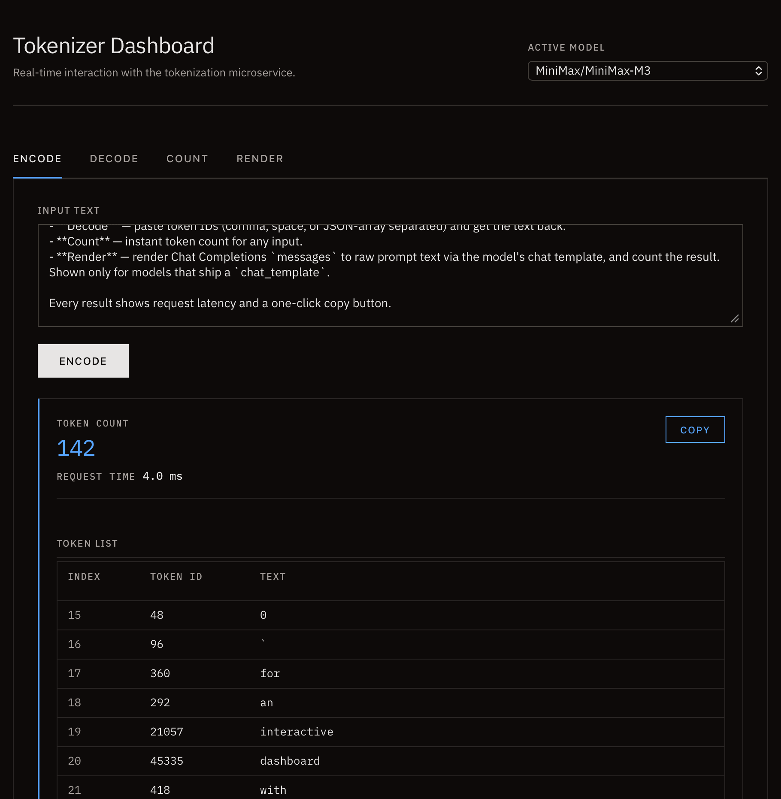

# Tokenizer Service (tokenizer-svc) &middot; 中文文档

> **一个自包含的二进制**，通过 HTTP、CLI 和内置 Web 控制台提供 LLM tokenizer 服务 —— 支持 **HuggingFace** 和 **ModelScope**。

[](https://github.com/vinxv/tokenizer-cli/actions/workflows/build.yml)
[](#开源许可)
[](https://www.rust-lang.org/)
[](https://github.com/vinxv/tokenizer-cli/releases)

[English](README.md) · [快速上手](#快速上手) · [HTTP API](#http-api) · [CLI](#cli-命令参考)

<p align="center">
  
</p>

---

## 为什么需要它

做 LLM 应用时，算 token 数、预切分文本、渲染 chat template 是日常操作——用于成本估算、限流、上下文预算和 RAG 切分。但现有工具各有短板：

- **`transformers`**：为了算个 token 要拉起 Python 运行时和数 GB 依赖。
- **`tiktoken`**：只支持 OpenAI 模型。

`tokenizer-svc` 是一个静态二进制（strip 后约 12 MB），同时给你 HTTP API、CLI 和 内置 Web 控制台用于交互调试，支持 HuggingFace 和 ModelScope，并内置 chat template 渲染。控制台完全自包含：字体已内嵌进二进制，运行时不向任何外部 CDN 发起请求。

---

## 快速上手

### 1. 下载

从 [GitHub Releases](https://github.com/vinxv/tokenizer-cli/releases) 下载对应平台的预编译二进制。

```bash
# macOS / Linux 示例：下载并赋予执行权限
curl -fsSL -o tokenizer-cli https://github.com/vinxv/tokenizer-cli/releases/latest/download/tokenizer-cli-$(uname -s)-$(uname -m)
chmod +x tokenizer-cli
```

### 2. 拉取模型

```bash
# 从 HuggingFace 拉取（默认）
./tokenizer-cli pull Qwen/Qwen3-32B

# 从 ModelScope 拉取
./tokenizer-cli pull Qwen/Qwen2.5-0.5B-Instruct --source modelscope
```

### 3. 启动服务

```bash
./tokenizer-cli serve --enable-web
```

浏览器打开 `http://localhost:8080`，搞定。

### 4. 或直接用 CLI

无需起服务——`count`、`encode`、`decode` 直接基于本地缓存工作：

```bash
./tokenizer-cli count  Qwen/Qwen3-32B "Hello world"
./tokenizer-cli encode Qwen/Qwen3-32B "Hello world"
./tokenizer-cli decode Qwen/Qwen3-32B 9707 1879
```

任意命令加 `--json` 可输出与 HTTP API 响应结构一致的 JSON。

> **从源码构建？** 见 [从源码构建](#从源码构建)。

---

## Web 控制台

运行 `serve --enable-web` 后打开 `http://localhost:8080`，即可使用包含四个标签页的交互式控制台：

- **Encode** — 将文本转为 token ID 和逐 token 表格（序号 / ID / 文本），长输入支持虚拟滚动。
- **Decode** — 粘贴 token ID（逗号、空格或 JSON 数组分隔均可），还原为文本。
- **Count** — 任意输入的即时 token 计数。
- **Render** — 通过模型的 chat template 将 Chat Completions `messages` 渲染为原始 prompt 文本，并统计 token 数。仅对自带 `chat_template` 的模型显示。

每个结果都显示请求耗时，并提供一键复制按钮。

---

## 功能特性

- **多 Hub 模型拉取**：从 **HuggingFace Hub** 和 **ModelScope** 下载 tokenizer 文件，本地缓存、按需加载。
- **统一 CLI**：单个二进制文件，可启动服务、拉取模型、执行 Token 操作。
- **HTTP API**：标准化的 token 计数、编码、解码、模型发现与 chat template 渲染接口。
- **Web 控制台**：可选的嵌入式 Web 调试界面。
- **懒加载与缓存**：模型按需加载，本地缓存复用。

---

## CLI 命令参考

`tokenizer-cli` 为主入口。任意命令加 `--json` 可输出机器可读的 JSON 格式。

| 命令 | 说明 |
| :--- | :--- |
| `serve` | 启动 HTTP API 服务，加 `--enable-web` 开启控制台 |
| `pull <model>` | 下载 tokenizer 文件到本地缓存 |
| `models` | 列出当前注册表中所有 tokenizer |
| `count <model> <text>` | 统计指定文本的 token 数 |
| `encode <model> <text>` | 将文本编码为 token ID |
| `decode <model> <ids...>` | 将 token ID 解码为文本 |
| `ping` | 服务健康检查 |
| `--help` | 打印完整帮助信息 |

---

## HTTP API

### GET `/v1/models`
返回缓存或已加载的全部模型列表。
每个模型包含 `has_chat_template`、`chat_template_source` 和 `chat_template_name` 字段，Web 控制台据此决定是否显示 Render 选项卡。

### POST `/v1/token/count`
**请求体**：`{"model": "Qwen/Qwen3-32B", "text": "Hello world"}`
**响应**：`{"model": "Qwen/Qwen3-32B", "count": 2}`

### POST `/v1/token/encode`
**请求体**：`{"model": "Qwen/Qwen3-32B", "text": "Hello world"}`
**响应**：`{"model": "Qwen/Qwen3-32B", "ids": [9707, 1879], "tokens": ["Hello", " world"]}`

### POST `/v1/token/decode`
**请求体**：`{"model": "Qwen/Qwen3-32B", "ids": [9707, 1879]}`
**响应**：`{"model": "Qwen/Qwen3-32B", "text": "Hello world"}`

### POST `/v1/chat/render`
将 Chat Completions 格式的 `messages` 渲染为原始 prompt 文本，并返回其 token 数量。
请求体中的额外字段会作为 Jinja 模板变量传入上下文。

模板解析优先级：
1. 从缓存 `tokenizer_config.json` 读取 `chat_template`。
2. 否则使用缓存的 `.jinja` 模板文件（如 `chat_template.jinja`）。
3. 若都不存在，返回 `INVALID_INPUT` 错误。

**请求体**：`{"model": "Qwen/Qwen3-32B", "messages": [{"role": "user", "content": "你好"}], "add_generation_prompt": true}`
**响应**：`{"model": "Qwen/Qwen3-32B", "text": "...", "count": 42, "template_source": "jinja_file", "template_name": "chat_template.jinja"}`

---

## 配置详解

服务通过 `config.yaml`、环境变量和 CLI 参数组合配置。优先级：**CLI 参数 > 环境变量 > config.yaml > 默认值**。

### config.yaml

在项目根目录创建 `config.yaml`（可参考 `config.example.yaml`）：

| 字段 | 类型 | 默认值 | 说明 |
| :--- | :--- | :--- | :--- |
| `host` | string | `0.0.0.0` | HTTP 服务器绑定地址 |
| `port` | u16 | `8080` | HTTP 服务器监听端口 |
| `cache_dir` | string | `~/.cache/tokenizer-svc` | 模型文件本地缓存目录 |
| `model_source` | string | `huggingface` | 模型下载 Hub：`huggingface` 或 `modelscope` |
| `hf_token` | string? | — | HuggingFace API Token（访问私有/受限模型） |
| `ms_token` | string? | — | ModelScope SDK Token（访问私有/受限模型） |
| `allow_online_download` | bool | `true` | 是否允许请求时自动下载模型；设为 `false` 则必须提前缓存 |

### 环境变量

所有配置项均可通过 `TOKSVC_` 前缀的环境变量覆盖：

| 环境变量 | 对应字段 |
| :--- | :--- |
| `TOKSVC_HOST` | `host` |
| `TOKSVC_PORT` | `port` |
| `TOKSVC_CACHE_DIR` | `cache_dir` |
| `TOKSVC_MODEL_SOURCE` | `model_source` |
| `TOKSVC_HF_TOKEN` | `hf_token` |
| `TOKSVC_MS_TOKEN` | `ms_token` |
| `TOKSVC_ALLOW_ONLINE_DOWNLOAD` | `allow_online_download` |

### CLI 参数

| 参数 | 适用命令 | 说明 |
| :--- | :--- | :--- |
| `--json` | 全局 | 以 JSON 格式输出（与 API 响应结构一致） |
| `--log-level` | 全局 | 日志级别：`error` / `warn` / `info` / `debug` / `trace`（默认 `info`） |
| `--enable-web` | `serve` | 开启嵌入式 Web 控制台 |
| `--source` | `pull` | 模型 Hub：`huggingface` 或 `modelscope` |
| `--token` | `pull` | HuggingFace API Token（覆盖 env/config） |
| `--ms-token` | `pull` | ModelScope SDK Token（覆盖 env/config） |

### 配置示例

```yaml
# config.yaml
host: "127.0.0.1"
port: 9090
cache_dir: "/data/tokenizer-cache"
model_source: "modelscope"
hf_token: "hf_your_token_here"
allow_online_download: false
```

```bash
# 环境变量覆盖端口 9090 → 3000
TOKSVC_PORT=3000 ./tokenizer-cli serve --enable-web
```

---

## 从源码构建

需要 [Rust](https://rustup.rs) 环境：

```bash
git clone https://github.com/vinxv/tokenizer-cli.git
cd tokenizer-cli
cargo build --release
```

二进制文件位于 `target/release/tokenizer-cli`。

---

## 开源许可

采用 [MIT 许可证](LICENSE) 授权。
